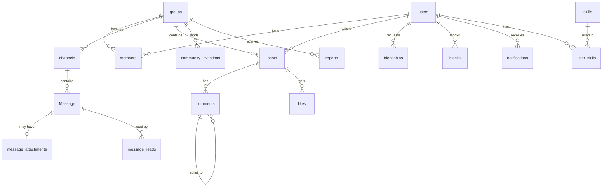

*This project has been created as part of the 42 curriculum by ashaheen, <maram_login>, hinajib, <worod_login>.*

<!--
  HOW TO USE THIS FILE (delete this comment before submission)
  - Shared sections are already written. Do not rewrite them alone. Suggest changes to the team.
  - Fill ONLY the blocks marked with your name, between START and END.
  - Follow the PXL_LAB README guide (PXL_LAB_README_Guide.docx in this folder). Use the same prompt (CHATGPT_PROMPT.txt).
  - This file lives in readme/ while we write it. At the end it moves to the repository root.
  - Lines marked [TODO] must be replaced. Search the file for [TODO] before the final merge.
-->

# PXL_LAB

**Big ideas. Small pixels.** PXL_LAB is a campus community web app for 42 students. Students join communities, chat in real time, share posts, add friends and find people by their skills.

## Table of contents

1. [Description](#description)
2. [Instructions](#instructions)
3. [Team Information](#team-information)
4. [Project Management](#project-management)
5. [Technical Stack](#technical-stack)
6. [Database Schema](#database-schema)
7. [Features List](#features-list)
8. [Modules](#modules)
9. [Individual Contributions](#individual-contributions)
10. [Resources](#resources)
11. [Known Limitations](#known-limitations)

---

## Description

### Goal

42 students learn by working together, but their conversations, projects and questions are spread across many apps. PXL_LAB brings them into one place: a community space where students meet, talk and share their work.

### Overview

- A student signs up with an email and password, then builds a profile with a display name, bio, avatar and skills.
- Students create or join **communities**. Each community has members with roles (owner, admin, moderator, member) and text **channels** for chat.
- Chat works in **real time**: typing indicators, read receipts, online status, file sharing (images and PDF) and blocking.
- The **feed** shows posts from the whole campus and from the student's communities, with images, likes and replies.
- **Notifications** arrive live for friend requests, invitations, replies, likes, and changes in communities and channels.
- **Search** finds people, communities, posts and skills, with filters, sorting and pages.
- A **site admin** manages user accounts and site roles (admin, user, guest). Guests can read but cannot change anything.

### Key features

| Feature | In one line |
|---|---|
| Communities | Create, edit and delete communities. Invite, add and remove members. Four member roles. |
| Real-time chat | Channels with typing indicators, read receipts, presence, images and PDF files. |
| Feed | Global and community posts with images, likes, nested replies and reports. |
| Friends | Friend requests, a friends list and online status. |
| Notifications | Live pop-ups, a badge and a notification page for every create, update and delete. |
| Search | People, communities, posts and skills, with filters, sorting and pagination. |
| Site administration | Admin page to view, edit and delete users and change their site role. |

---

## Instructions

### Prerequisites

| Tool | Version |
|---|---|
| Docker Engine | [TODO: version] |
| Docker Compose | [TODO: version] |
| Make | any |
| A modern browser | Latest Google Chrome |

[TODO Heba (Tech Lead): confirm the list once the Docker setup is final.]

### Environment variables

Copy the example files and fill in the secrets. The real `.env` files are ignored by Git.

```bash
cp ft_transcendence/transcendence-backend/.env.example ft_transcendence/transcendence-backend/.env
cp ft_transcendence/frontend/.env.example ft_transcendence/frontend/.env
```

| Variable | Where | Meaning |
|---|---|---|
| `DATABASE_URL` | backend | PostgreSQL connection string |
| `JWT_SECRET` | backend | Long random secret used to sign login tokens |
| `JWT_EXPIRES_IN_SECONDS` | backend | Login token lifetime (default 900) |
| `PORT` | backend | API port inside the container (default 3000) |
| `VITE_API_URL` | frontend | Public URL of the API |
| `VITE_SOCKET_URL` | frontend | Public URL of the chat server |

### Run the project

[TODO Heba (Tech Lead): replace with the final single command and the real URL.]

```bash
make            # or: docker compose up --build
```

Then open **https://localhost:[TODO port]** in Chrome.

### First site administrator

Public sign-up never creates an admin. To make an existing account an admin:

```bash
[TODO Heba (Tech Lead): the docker command that runs] npm run admin:promote -- <username>
```

### Tests

```bash
cd ft_transcendence/transcendence-backend && npm test     # backend unit tests
cd ft_transcendence/frontend && npm run lint             # frontend lint and type check
```

---

## Team Information

<!-- Roles were agreed on the first day of the project. Each member writes 3 to 5 responsibilities for her role(s). Afnan explains the Frontend Monitor role, which the team added. -->

| Member | Login | Role(s) |
|---|---|---|
| Afnan Shaheen | ashaheen | Frontend Monitor, Developer (Frontend) |
| Maram [TODO surname] | [TODO] | Project Manager (PM), Developer (Frontend) |
| Heba [TODO surname] | hinajib | Tech Lead, Developer (Backend) |
| Worod [TODO surname] | [TODO] | Product Owner (PO), Developer (Backend) |

**Afnan Shaheen** — Frontend Monitor, Developer (Frontend)
- Built interactive frontend features for the feed, chat, notifications, and search.
- Connected frontend components to backend API endpoints and WebSocket (Socket.IO) events.
- Tested frontend features with the team backend and fixed integration issues.
- Monitored frontend structure, shared components, and API integration.

<!-- MARAM: START (Team Information) -->
**Maram [TODO]** — Project Manager (PM), Developer (Frontend)
- [TODO responsibility]
- [TODO responsibility]
- [TODO responsibility]
<!-- MARAM: END -->

<!-- HEBA: START (Team Information) -->
**Heba [TODO]** — Tech Lead, Developer (Backend)
- [TODO responsibility]
- [TODO responsibility]
- [TODO responsibility]
<!-- HEBA: END -->

<!-- WOROD: START (Team Information) -->
**Worod [TODO]** — Product Owner (PO), Developer (Backend)
- [TODO responsibility]
- [TODO responsibility]
- [TODO responsibility]
<!-- WOROD: END -->

---

## Project Management

<!-- Maram (PM) writes this section for the whole team. Use "we". -->

### How we organized the work

- [TODO: how tasks were split (frontend core, frontend interactive, backend core, backend realtime).]
- [TODO: weekly plan and meetings (when, how often, what we decided in them).]
- [TODO: how we reviewed and merged work (branches per member, then `frontend-merge` and `main`).]

### Tools

| Purpose | Tool |
|---|---|
| Code and version control | GitHub (`Heva123/ft_transcendence`) |
| Task tracking | [TODO: GitHub Issues / Trello / Notion] |
| Design | [TODO: Figma or other] — the UI/UX design file "PXL_LAB ft_transcendence UI/UX" |
| Communication | [TODO: WhatsApp / Discord / Slack] |

---

## Technical Stack

| Layer | Technology | Why we chose it |
|---|---|---|
| Frontend | React 19, TypeScript, Vite, React Router 7 | React is a widely used framework with a large ecosystem. TypeScript catches errors before runtime. Vite gives fast builds. |
| Styling | Plain CSS with design tokens (`styles/tokens.css`) | One shared palette, spacing and typography for every screen, following our UI/UX design. |
| Real-time | Socket.IO (client and server) | Reliable WebSocket connection with automatic reconnection and rooms per channel. |
| Backend | NestJS 11 (Node.js, TypeScript) | Clear structure with modules, guards and dependency injection. The same language as the frontend. |
| Database | PostgreSQL 17 | Relational data (users, communities, members, messages) with strong consistency. |
| ORM | Prisma 6 | Typed queries, a readable schema and versioned migrations. |
| Authentication | JWT (passport-jwt), bcrypt password hashing | Stateless login tokens. Passwords are salted and hashed, never stored in plain text. |
| Validation | class-validator (backend), form checks (frontend) | Every input is checked on both sides. |
| API documentation | Swagger (OpenAPI) at `/api/docs` | Every endpoint is documented and can be tried in the browser. |
| Testing | Jest (backend unit tests), ESLint and TypeScript checks (frontend) | [TODO: number] unit tests run with `npm test`. |
| Deployment | Docker, Docker Compose, [TODO: nginx/Caddy] with HTTPS | One command starts the whole project. |

---

## Database Schema

PostgreSQL database managed with Prisma migrations. Main tables and how they connect:



| Table | Key fields | Purpose |
|---|---|---|
| `users` | `id` (UUID), `email` (unique), `username` (unique), `passwordHash`, `siteRole` (ADMIN, USER, GUEST), `displayName`, `bio`, `avatarPath`, `lastSeenAt` | Accounts and profiles |
| `groups` | `id`, `name`, `description`, `isPublic`, `createdById` | Communities |
| `members` | `userId`, `communityId`, `role` (OWNER, ADMIN, MODERATOR, MEMBER) | Who belongs to which community, with which role |
| `channels` | `id`, `communityId`, `name` (unique per community), `description` | Chat channels inside a community |
| `Message` | `id`, `channelId`, `authorId`, `content`, `createdAt` | Chat messages |
| `message_attachments` | `id`, `messageId`, `mimeType`, `size`, `path` | Images and PDF files sent in chat |
| `message_reads` | `messageId`, `userId`, `readAt` | Read receipts |
| `posts` | `id`, `authorId`, `communityId` (empty for the global feed), `content`, `imagePath` | Feed posts |
| `comments` | `id`, `postId`, `authorId`, `parentId`, `content` | Replies, including replies to replies |
| `likes` | `postId`, `userId` | One like per user per post |
| `friendships` | `requesterId`, `addresseeId`, `status` (PENDING, ACCEPTED) | Friend requests and friends |
| `blocks` | `blockerId`, `blockedId` | Blocked users |
| `community_invitations` | `communityId`, `inviterId`, `inviteeId`, `role`, `status` | Invitations by username |
| `reports` | `communityId`, `reporterId`, `targetType`, `reason`, `status` | Reports of posts or replies |
| `notifications` | `userId`, `type`, `title`, `message`, `link`, `isRead` | Notifications shown in the app |
| `skills`, `user_skills` | `name`, `userId`, `skillId` | Skills on profiles, used by search |

[TODO Heba: check field names against `prisma/schema.prisma` and remove the `projects` and `tasks` tables from the schema, or add them here with a reason.]

---

## Features List

<!-- Each member checks the rows with her name. Add a row if a feature is missing. Keep one line per description. -->

| Feature | What it does | Who |
|---|---|---|
| Sign up and log in | Email and password accounts, validation on both sides, hashed passwords, JWT sessions | Maram (UI), Heba (API) |
| Profiles | Display name, bio, skills, avatar with a default image, public profile page | Maram, Afnan (UI), Heba (API), Worod (uploads) |
| Settings | Edit account details, blocked users | Maram |
| Friends | Friend requests, accept, remove, friends list with online status | Afnan (UI), Heba (API) |
| Communities | Create, edit, delete, discover, join, leave | Maram (UI), Heba (API) |
| Members and roles | Invite by username, change roles, remove members, roles page | Maram, Afnan (UI), Heba (API) |
| Channels | Create, edit and delete channels by role | Afnan (UI), Heba (API) |
| Real-time chat | Messages, typing, read receipts, presence, unread counters, reconnect | Afnan (UI), Worod (server) |
| Files in chat | Images and PDF with preview, download, type and size checks, access control | Afnan (UI), Worod (API) |
| Blocking | Block and unblock users, hidden messages | Afnan (UI), Worod, Heba (API) |
| Feed and posts | Global and community feed, images, likes, nested replies, edit, delete, paging | Afnan (UI), Worod (API) |
| Reports | Report posts and replies, reviewers are notified | Afnan (UI), Worod (API) |
| Notifications | Live pop-ups, badge, unread filter, a notification for every create, update and delete | Afnan (UI), Worod, Heba (API) |
| Search | People, communities, posts and skills, filters, sorting, pagination | Afnan (UI), Worod (API) |
| Site administration | Admin page, site roles, guest read-only access | Maram (UI), Heba (API) |
| Privacy Policy and Terms | Public legal pages linked from the app | Afnan, Maram |
| [TODO] | [TODO] | [TODO] |

---

## Modules

**Total: 16 points** (14 required). [TODO: confirm the final list as a team.]

| Module | Type | Points | Who |
|---|---|---|---|
| Use a framework for frontend and backend (React + NestJS) | Major | 2 | Everyone |
| Real-time features with WebSockets | Major | 2 | Worod, Afnan |
| User interaction: chat, profiles, friends | Major | 2 | Afnan, Worod, Heba |
| Standard user management and authentication | Major | 2 | Heba, Maram |
| Organization system (communities) | Major | 2 | Heba, Maram |
| Advanced permissions system | Major | 2 | Heba, Maram |
| Use an ORM (Prisma) | Minor | 1 | Heba, Worod |
| Notification system for all create, update and delete actions | Minor | 1 | Worod, Heba, Afnan |
| Advanced search with filters, sorting and pagination | Minor | 1 | Worod, Afnan |
| File upload and management | Minor | 1 | Worod, Afnan |
| **Total** | | **16** | |

<!-- One writer per module (marked below). The others check it. -->

<!-- MARAM: START (Module) -->
### Frameworks (Major, 2 pts)
- **Why we chose it:** [TODO]
- **How it works:** [TODO]
<!-- MARAM: END -->

<!-- WOROD: START (Module) -->
### Real-time features (Major, 2 pts)
- **Why we chose it:** [TODO]
- **How it works:** [TODO]
<!-- WOROD: END -->

### User interaction (Major, 2 pts)
- **Why we chose it:** We wanted 42 students to connect and communicate inside PXL_LAB. Users can build profiles, add friends, and chat in real time. This helps students interact and stay connected within their communities.

- **How it works:** Users create profiles with an avatar, bio, and skills. They can send, accept, and remove friend requests. The frontend displays friends and their online status. `ChatArea.tsx` and `useChatSocket.ts` handle messages, typing indicators, and read receipts through WebSocket (Socket.IO).

<!-- HEBA: START (Module) -->
### Standard user management (Major, 2 pts)
- **Why we chose it:** [TODO]
- **How it works:** [TODO]
<!-- HEBA: END -->

<!-- MARAM: START (Module) -->
### Organization system (Major, 2 pts)
- **Why we chose it:** [TODO]
- **How it works:** [TODO]
<!-- MARAM: END -->

<!-- HEBA: START (Module) -->
### Advanced permissions (Major, 2 pts)
- **Why we chose it:** [TODO]
- **How it works:** [TODO]
<!-- HEBA: END -->

<!-- WOROD: START (Module) -->
### ORM (Minor, 1 pt)
- **Why we chose it:** [TODO]
- **How it works:** [TODO]
<!-- WOROD: END -->

### Notification system (Minor, 1 pt)
 **Why we chose it:** We wanted students to know when something important happens. Notifications help users follow friend requests, replies, likes, and community activity.
- **How it works:** The backend creates notification records for supported actions. WebSocket (Socket.IO) sends notification updates in real time. The frontend uses `useNotifications.ts` and `notificationSocket.ts` to receive updates. The interface displays pop-ups, unread counts, and notification lists.

### Advanced search (Minor, 1 pt)
 **Why we chose it:** We wanted students to find people and content without checking every page. Filters, sorting, and pagination make search results easier to explore.
- **How it works:** `SearchPage.tsx` provides search interfaces for people, communities, posts, and skills. Users enter search terms and select available filters or sorting options. `usePagedSearch.ts` manages requests and paginated results. The backend API returns matching records from the database.

<!-- WOROD: START (Module) -->
### File upload and management (Minor, 1 pt)
- **Why we chose it:** [TODO]
- **How it works:** [TODO]
<!-- WOROD: END -->

---

## Individual Contributions

<!-- Same structure for everyone. See the PXL_LAB README guide. -->

### Afnan Shaheen

**Summary.** Afnan developed interactive frontend features for PXL_LAB using React and TypeScript. She connected the feed, chat, notifications, and search to the team backend.

**What she built**
- **Feed and posts.** Users view global and community posts, add likes, and write replies. Afnan built `Feed.tsx`, `PostCard.tsx`, and `feedApi.ts`.
- **Nested replies.** Users reply to posts and other replies. Afnan developed the reply interface using `ReplyItem.tsx`.
- **Real-time chat.** The channel interface shows messages, typing indicators, read receipts, and online members. She worked on `ChatArea.tsx` and `useChatSocket.ts`.
- **Chat file attachments.** Users send images and PDF files through chat. She added file selection and upload handling using `ImageAttachmentPicker.tsx` and `uploadRequest()`.
- **Notifications.** The frontend shows notification pop-ups, unread counts, and notification lists. She worked on `useNotifications.ts` and `notificationSocket.ts`.
- **Advanced search.** Users search for people, communities, posts, and skills. She implemented frontend search and pagination using `SearchPage.tsx` and `usePagedSearch.ts`.
- **Frontend API integration.** Afnan prepared feed API integration and configured the frontend API proxy. She also changed frontend code to handle string IDs consistently.
- **Shared application layout.** Afnan built reusable layout components, including `AppShell.tsx`, `Sidebar.tsx`, and `TopBar.tsx`.

**Challenges**
- **Unexpected logouts.** Some page loads ended with a session error during multi-user testing. Afnan traced the issue to an early `auth:error` event. She changed the flow to check the login through the API before logging out.
- **Chat reconnection.** Chat stopped receiving messages after the backend restarted. She updated the frontend to join the channel again after reconnecting.
- **Frontend and backend integration.** Some frontend features needed changes to match backend data and endpoints. She updated frontend ID handling, prepared API integration, and tested the changes with the team backend.

<!-- MARAM: START (Individual Contributions) -->
### Maram [TODO]

**Summary.** [TODO: 2 sentences.]

**What she built**
- [TODO]

**Challenges**
- **[TODO challenge title].** [TODO] [TODO]

<!-- MARAM: END -->

<!-- HEBA: START (Individual Contributions) -->
### Heba [TODO]

**Summary.** [TODO: 2 sentences.]

**What she built**
- [TODO]

**Challenges**
- **[TODO challenge title].** [TODO] [TODO]

<!-- HEBA: END -->

<!-- WOROD: START (Individual Contributions) -->
### Worod [TODO]

**Summary.** [TODO: 2 sentences.]

**What she built**
- [TODO]

**Challenges**
- **[TODO challenge title].** [TODO] [TODO]

<!-- WOROD: END -->

---

## Resources

### References

| Topic | Link |
|---|---|
| React | https://react.dev |
| Vite | https://vite.dev |
| React Router | https://reactrouter.com |
| NestJS | https://docs.nestjs.com |
| Prisma | https://www.prisma.io/docs |
| PostgreSQL | https://www.postgresql.org/docs |
| Socket.IO | https://socket.io/docs/v4 |
| JWT | https://jwt.io/introduction |
| OWASP password storage | https://cheatsheetseries.owasp.org/cheatsheets/Password_Storage_Cheat_Sheet.html |
| WCAG 2.1 | https://www.w3.org/TR/WCAG21 |
| [TODO: add the tutorials and articles you really used] | |

### How we used AI

<!-- Be honest and specific. The subject requires which tasks and which parts. Each member adds her own bullets. -->

We used AI tools as assistants. Every result was read, tested and changed by us before it went into the project.

- **Afnan** — ChatGPT helped explain React and TypeScript concepts and review frontend integration problems. She used it while working on components, API requests, chat, and notifications. She reviewed the suggested changes, tested the frontend with the team backend, and checked the results in the browser.
- 
<!-- MARAM: START (AI) -->
- **Maram** — [TODO]
<!-- MARAM: END -->
<!-- HEBA: START (AI) -->
- **Heba** — [TODO]
<!-- HEBA: END -->
<!-- WOROD: START (AI) -->
- **Worod** — [TODO]
<!-- WOROD: END -->

---

## Known Limitations

- Tested in Google Chrome. [TODO: other browsers tested, or "Other browsers are not officially supported."]
- Reports can be sent and reviewed through the API, but there is no moderation screen yet.
- [TODO]

## License and credits

Made by the PXL_LAB team at 42 Abu Dhabi for the ft_transcendence project. [TODO: license, or "All rights reserved."]
