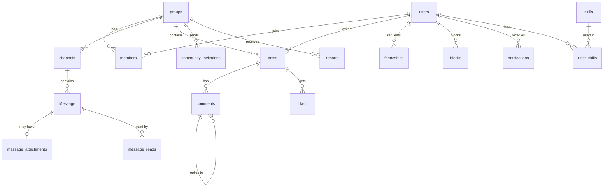

*This project has been created as part of the 42 curriculum by ashaheen, maabdulr, hinajib, wuabdull.*

# PXL_LAB

**Big ideas. Small pixels.** PXL_LAB is a campus community web app for 42 students. Students join communities, chat in real time, share posts, add friends and find people by their skills.

## Table of contents

1. [Description](#description)
2. [Instructions](#instructions)
3. [Team Information](#team-information)
4. [Project Management](#project-management)
5. [Technical Stack](#technical-stack)
6. [Database Schema](#database-schema)
7. [Features List](#features-list)
8. [Modules](#modules)
9. [Individual Contributions](#individual-contributions)
10. [Resources](#resources)
11. [Known Limitations](#known-limitations)

---

## Description

### Goal

42 students learn by working together, but their conversations, projects and questions are spread across many apps. PXL_LAB brings them into one place: a community space where students meet, talk and share their work.

### Overview

- A student signs up with an email and password, then builds a profile with a display name, bio, avatar and skills.
- Students create or join **communities**. Each community has members with roles (owner, admin, moderator, member) and text **channels** for chat.
- Chat works in **real time**: typing indicators, read receipts, online status, file sharing (images and PDF) and blocking.
- The **feed** shows posts from the whole campus and from the student's communities, with images, likes and replies.
- **Notifications** arrive live for friend requests, invitations, replies, likes, and changes in communities and channels.
- **Search** finds people, communities, posts and skills, with filters, sorting and pages.
- A **site admin** manages user accounts and site roles (admin, user, guest). Guests can read but cannot change anything.

### Key features

| Feature | In one line |
|---|---|
| Communities | Create, edit and delete communities. Invite, add and remove members. Four member roles. |
| Real-time chat | Channels with typing indicators, read receipts, presence, images and PDF files. |
| Feed | Global and community posts with images, likes, nested replies and reports. |
| Friends | Friend requests, a friends list and online status. |
| Notifications | Live pop-ups, a badge and a notification page for every create, update and delete. |
| Search | People, communities, posts and skills, with filters, sorting and pagination. |
| Site administration | Admin page to view, edit and delete users and change their site role. |

---

## Instructions

### Prerequisites

| Tool | Version |
|---|---|
| Docker Engine | Any recent version (tested on the 42 Abu Dhabi lab computers) |
| Docker Compose | v2 with `--wait` (check with `docker compose version`) |
| Make | any |
| A modern browser | Latest Google Chrome |

### Environment variables

The first `make` creates `ft_transcendence/.env` with a random database password and a random JWT secret. This file is ignored by Git. The template is `ft_transcendence/.env.example`.

| Variable | Meaning |
|---|---|
| `POSTGRES_USER`, `POSTGRES_PASSWORD`, `POSTGRES_DB` | Database login and name |
| `JWT_SECRET` | Long random secret used to sign login tokens |
| `JWT_EXPIRES_IN_SECONDS` | Login token lifetime (default 900) |
| `HTTP_PORT`, `HTTPS_PORT` | Ports on your computer (default 8080 and 8443) |

### Run the project

From the repository root, run:

```bash
make
```

This builds the frontend and backend, starts PostgreSQL, applies database migrations, and starts nginx.

Open **https://localhost:8443** in Chrome. HTTP requests to `http://localhost:8080` redirect to HTTPS.

The local certificate is self-signed. Chrome may show a warning until you trust it. See `ft_transcendence/DOCKER.md` for instructions.

### First site administrator

Public sign-up does not create an administrator. First, sign up for an account. Then run:

```bash
cd ft_transcendence
docker compose --env-file .env -f compose.yml exec backend node scripts/set-site-admin.cjs <username>
```

Replace `<username>` with the username of the account you want to promote.

### Tests

```bash
cd ft_transcendence/transcendence-backend && npm test    # 117 backend unit tests
cd ft_transcendence/frontend && npm run lint             # frontend lint and type check
```

Before submission, the team also ran end-to-end tests on the Docker version with Playwright: four users at the same time in Chromium, Firefox and WebKit. All 205 end-to-end checks passed.

---

## Team Information

<!-- Roles were agreed on the first day of the project. Each member writes 3 to 5 responsibilities for her role(s). Afnan explains the Frontend Monitor role, which the team added. -->

| Member | Login | Role(s) |
|---|---|---|
| Afnan Shaheen | ashaheen | Frontend Monitor, Developer (Frontend) |
| Maram Abdulrashed | maabdulr | Project Manager (PM), Developer (Frontend) |
| Hiba Najib | hinajib | Tech Lead, Developer (Backend) |
| Wurood Abdullah | wuabdull | Product Owner (PO), Developer (Backend) |

**Afnan Shaheen** — Frontend Monitor, Developer (Frontend)
- Built interactive frontend features for the feed, chat, notifications, and search.
- Connected frontend components to backend API endpoints and WebSocket (Socket.IO) events.
- Tested frontend features with the team backend and fixed integration issues.
- Monitored frontend structure, shared components, and API integration.
- Planned and ran the end-to-end tests with four users, and reported each failure to its owner.

**Maram Abdulrashed** — Project Manager (PM), Developer (Frontend)
- Managed task planning, frontend responsibilities, and integration work across the team.
- Built core frontend pages for communities, members, profiles, and site administration.
- Reviewed shared frontend changes and tested builds before integration.
- Coordinated frontend work through member branches and the shared `frontend-merge` branch.

**Hiba Najib** — Tech Lead + Developer
- Developed the core backend using NestJS, PostgreSQL and Prisma.
- Implemented authentication, community permissions and site administration.
- Integrated backend additions and verified migrations, API behaviour and production builds.

<!-- WOROD: START (Team Information) -->
**Wurood Abdullah** — Product Owner (PO), Developer (Backend)
- Defined and reviewed PXL_LAB feature requirements and user workflows.
- Developed backend features for chat, social interactions, uploads, and search.
- Integrated backend functionality with the shared team application.
- Investigated bugs, added regression tests, and verified builds before integration.
<!-- WOROD: END -->

---

## Project Management

### How we organized the work

- We split development between frontend core, frontend interactive features, backend core, and real-time backend features.
- We used weekly task plans and team check-ins to review progress, blockers, integration, and remaining work.
- Each member worked on a personal branch before shared integration.
- Frontend work was combined in `frontend-merge` before the final merge into `main`.
- We tested integrated features before moving completed work into the final branch.

### Tools

| Purpose | Tool |
|---|---|
| Code and version control | GitHub (`Heva123/ft_transcendence`) |
| Task tracking | Weekly team task plan |
| Design | Figma |
| Communication | WhatsApp |


---

## Technical Stack

| Layer | Technology | Why we chose it |
|---|---|---|
| Frontend | React 19, TypeScript, Vite, React Router 7 | React is a widely used framework with a large ecosystem. TypeScript catches errors before runtime. Vite gives fast builds. |
| Styling | Tailwind CSS v4 with our design tokens (`styles/tailwind.css`, `styles/tokens.css`) | The Tailwind theme uses the same colours, fonts, radius and shadow as our Figma design, so utility classes and the per-screen CSS files look the same. Utility classes keep a component's style next to its markup. |
| Real-time | Socket.IO (client and server) | Reliable WebSocket connection with automatic reconnection and rooms per channel. |
| Backend | NestJS 11 (Node.js, TypeScript) | Clear structure with modules, guards and dependency injection. The same language as the frontend. |
| Database | PostgreSQL 17 | Relational data (users, communities, members, messages) with strong consistency. |
| ORM | Prisma 6 | Typed queries, a readable schema and versioned migrations. |
| Authentication | JWT (passport-jwt), bcrypt password hashing | Stateless login tokens. Passwords are salted and hashed, never stored in plain text. |
| Validation | class-validator (backend), form checks (frontend) | Every input is checked on both sides. |
| API documentation | Swagger (OpenAPI) at `/api/docs` | Every endpoint is documented and can be tried in the browser. |
| Testing | Jest (backend unit tests), Playwright (end-to-end tests), ESLint and TypeScript checks (frontend) | 117 backend tests passed across 18 Jest suites (verified October 27, 2026). 205 end-to-end checks with four users passed on the Docker version. |
| Deployment | Docker, Docker Compose, nginx 1.28 with HTTPS | One command starts the whole project. Only nginx is open to the host. |

### Project structure

```
ft_transcendence/
├── compose.yml, Makefile, .env.example   one-command start
├── docker/                               web image, nginx config, certificate and .env scripts
├── frontend/src/
│   ├── api/  components/  layout/        shared code used by every screen
│   ├── routes/  styles/  utils/
│   └── features/                         one folder per feature
│       ├── admin/  auth/  chat/  communities/  feed/  friends/  invitations/
│       └── legal/  notifications/  presence/  profile/  reports/  search/
│           └── api/  components/  hooks/  pages/  types/  utils/   (same folders in every feature)
└── transcendence-backend/
    ├── prisma/                           database schema and migrations
    └── src/                              one NestJS module per feature (controller, service, DTOs, tests)
```

Most frontend features have a backend module with the same name (admin, auth, communities, friends, invitations, notifications, reports, search), so a feature is easy to find on both sides.

---

## Database Schema

PostgreSQL database managed with Prisma migrations. Main tables and how they connect:



| Table | Key fields | Purpose |
|---|---|---|
| `users` | `id`, `email`, `username`, `passwordHash`, `siteRole`, `displayName`, `bio`, `avatarPath`, `lastSeenAt` | Accounts and profiles. Email and username are unique. |
| `groups` | `id`, `name`, `description`, `isPublic`, `createdById` | Communities |
| `members` | `userId`, `groupId`, `role` | Community membership and member roles |
| `channels` | `id`, `communityId`, `name`, `description` | Chat channels inside a community. Names are unique within each community. |
| `projects` | `id`, `name`, `description`, `groupId`, `createdById` | Projects associated with a community |
| `tasks` | `id`, `title`, `status`, `priority`, `projectId`, `createdById`, `assigneeId` | Tasks associated with a project |
| `Message` | `id`, `channelId`, `authorId`, `content`, `createdAt` | Chat messages |
| `message_attachments` | `id`, `messageId`, `mimeType`, `size`, `path` | Files attached to chat messages |
| `message_reads` | `messageId`, `userId`, `readAt` | Read receipts |
| `posts` | `id`, `authorId`, `communityId`, `content`, `imagePath` | Feed posts. `communityId` is empty for global posts. |
| `comments` | `id`, `postId`, `authorId`, `parentId`, `content` | Replies, including replies to replies |
| `likes` | `postId`, `userId` | One like per user per post |
| `friendships` | `requesterId`, `addresseeId`, `status` | Friend requests and accepted friendships |
| `blocks` | `blockerId`, `blockedId` | Blocked users |
| `community_invitations` | `communityId`, `inviterId`, `inviteeId`, `role`, `status` | Community invitations |
| `reports` | `communityId`, `reporterId`, `targetType`, `reason`, `status` | Reports of posts or replies |
| `notifications` | `userId`, `type`, `title`, `message`, `link`, `isRead` | Notifications shown in the app |
| `skills` | `id`, `name` | Shared skill names |
| `user_skills` | `userId`, `skillId` | Links users to skills |

The `projects` and `tasks` tables support existing backend APIs.

## Features List

<!-- Each member checks the rows with her name. Add a row if a feature is missing. Keep one line per description. -->

| Feature | What it does | Who |
|---|---|---|
| Sign up and log in | Email and password accounts, validation on both sides, hashed passwords, JWT sessions | Maram (UI), Hiba (API) |
| Profiles | Display name, bio, skills, avatar with a default image, public profile page | Maram, Afnan (UI), Hiba (API), Wurood (uploads) |
| Settings | Edit account details, blocked users | Maram |
| Friends | Friend requests, accept, remove, friends list with online status | Afnan (UI), Hiba (API) |
| Communities | Create, edit, delete, discover, join, leave | Maram (UI), Hiba (API) |
| Members and roles | Invite by username, change roles, remove members, roles page | Maram, Afnan (UI), Hiba (API) |
| Channels | Create, edit and delete channels by role | Afnan (UI), Hiba (API) |
| Real-time chat | Messages, typing, read receipts, presence, unread counters, reconnect | Afnan (UI), Wurood (server) |
| Files in chat | Images and PDF with preview, download, type and size checks, access control | Afnan (UI), Wurood (API) |
| Blocking | Block and unblock users, hidden messages | Afnan (UI), Wurood, Hiba (API) |
| Feed and posts | Global and community feed, images, likes, nested replies, edit, delete, paging | Afnan (UI), Wurood (API) |
| Reports | Report posts and replies. Owners, admins and moderators review them in the moderation queue, keep or remove the content, and resolve or dismiss the report. | Afnan (report form), Maram (queue), Wurood, Hiba (API) |
| Notifications | Live pop-ups, badge, unread filter, a notification for every create, update and delete | Afnan (UI), Wurood, Hiba (API) |
| Search | People, communities, posts and skills, filters, sorting, pagination | Afnan (UI), Wurood (API) |
| Site administration | Admin page, site roles, guest read-only access | Maram (UI), Hiba (API) |
| Privacy Policy and Terms | Public legal pages linked from the app | Afnan, Maram |

---

## Modules

**Total: 16 points** (14 required).

| Module | Type | Points | Who |
|---|---|---|---|
| Use a framework for frontend and backend (React + NestJS) | Major | 2 | Everyone |
| Real-time features with WebSockets | Major | 2 | Wurood, Afnan |
| User interaction: chat, profiles, friends | Major | 2 | Afnan, Wurood, Hiba |
| Standard user management and authentication | Major | 2 | Hiba, Maram |
| Organization system (communities) | Major | 2 | Hiba, Maram |
| Advanced permissions system | Major | 2 | Hiba, Maram |
| Use an ORM (Prisma) | Minor | 1 | Hiba, Wurood |
| Notification system for all create, update and delete actions | Minor | 1 | Wurood, Hiba, Afnan |
| Advanced search with filters, sorting and pagination | Minor | 1 | Wurood, Afnan |
| File upload and management | Minor | 1 | Wurood, Afnan |
| **Total** | | **16** | |

<!-- One writer per module (marked below). The others check it. -->

### Frameworks (Major, 2 pts)
- **Why we chose it:** React gives the frontend reusable components and clear state management. NestJS gives the backend a structured module system. TypeScript is used on both sides and helps detect errors before runtime.
- **How it works:** The frontend uses React 19, TypeScript, React Router, and Vite. NestJS 11 structures the backend using modules, controllers, and services. The frontend communicates with the backend through API requests.

<!-- WOROD: START (Module) -->
### Real-time features (Major, 2 pts)
- **Why we chose it:** Students need immediate communication without refreshing the page. WebSockets support live chat, typing indicators, read receipts, and online presence.
- **How it works:** NestJS uses Socket.IO through `chat.gateway.ts`. Clients authenticate using JWT, join authorized channel rooms, exchange messages, and receive presence and typing events. Messages and read states are persisted through Prisma. The gateway also waits for authentication before processing early events.
<!-- WOROD: END -->

### User interaction (Major, 2 pts)
- **Why we chose it:** We wanted 42 students to connect and communicate inside PXL_LAB. Users can build profiles, add friends, and chat in real time. This helps students interact and stay connected within their communities.

- **How it works:** Users create profiles with an avatar, bio, and skills. They can send, accept, and remove friend requests. The frontend displays friends and their online status. `ChatArea.tsx` and `useChatSocket.ts` handle messages, typing indicators, and read receipts through WebSocket (Socket.IO).


### Standard user management (Major, 2 pts)
- **Why we chose it:** Every student needs a secure account, an editable profile, an avatar and an online status. Accounts are the base for every other feature.
- **How it works:** Students sign up and log in through `auth.controller.ts`. Passwords are hashed with bcrypt, and JWT authentication protects account endpoints. Users edit their profiles through `PATCH /api/users/me`. Profiles include avatars, bios and skills, with a default image when no avatar is uploaded.


### Organization system (Major, 2 pts)
- **Why we chose it:** Communities give students dedicated spaces for shared interests and discussions. Member roles control how each student manages a community.
- **How it works:** Users can discover, create, join, and leave communities. `CommunitiesPage.tsx` and `DiscoverCommunitiesPage.tsx` display community information. `CommunityMembersPage.tsx` manages members and member roles. Communities support owner, admin, moderator, and member roles.


### Advanced permissions (Major, 2 pts)
- **Why we chose it:** Communities need owners, admins and moderators, and the site needs administrators and read-only guests. Site roles keep account administration separate from community permissions.
- **How it works:** Prisma stores each account's site role as admin, user or guest. `SiteAdminGuard` restricts `/api/admin/users` to site administrators. Administrators can list, create, edit and delete accounts. Guest write restrictions apply to HTTP endpoints and WebSocket (Socket.IO) chat events.


<!-- WOROD: START (Module) -->
### ORM (Minor, 1 pt)
- **Why we chose it:** Prisma provides a typed and structured way to interact with PostgreSQL, manage relationships, and maintain the database schema.
- **How it works:** Database models and relationships are defined in `prisma/schema.prisma`. NestJS services use `PrismaService` to query and update users, communities, posts, messages, notifications, and other records. Prisma migrations manage schema changes.
<!-- WOROD: END -->

### Notification system (Minor, 1 pt)
- **Why we chose it:** We wanted students to know when something important happens. Notifications help users follow friend requests, replies, likes, and community activity.
- **How it works:** The backend creates notification records for supported actions. WebSocket (Socket.IO) sends notification updates in real time. The frontend uses `useNotifications.ts` and `notificationSocket.ts` to receive updates. The interface displays pop-ups, unread counts, and notification lists.

### Advanced search (Minor, 1 pt)
- **Why we chose it:** We wanted students to find people and content without checking every page. Filters, sorting, and pagination make search results easier to explore.
- **How it works:** `SearchPage.tsx` provides search interfaces for people, communities, posts, and skills. Users enter search terms and select available filters or sorting options. `usePagedSearch.ts` manages requests and paginated results. The backend API returns matching records from the database.

<!-- WOROD: START (Module) -->
### File upload and management (Minor, 1 pt)
- **Why we chose it:** Students need to share avatars, post images, and chat attachments securely within the application.
- **How it works:** `uploads.controller.ts` and `uploads.service.ts` manage uploading, retrieving, and deleting files. Upload validation checks allowed file types, extensions, and size limits. JWT authentication and resource access checks protect supported upload operations.
<!-- WOROD: END -->

---

## Individual Contributions

<!-- Same structure for everyone. See the PXL_LAB README guide. -->

### Afnan Shaheen

**Summary.** Afnan developed interactive frontend features for PXL_LAB using React and TypeScript. She connected the feed, chat, notifications, and search to the team backend.

**What she built**
- **Feed and posts.** Users view global and community posts, add likes, and write replies. Afnan built `Feed.tsx`, `PostCard.tsx`, and `feedApi.ts`.
- **Nested replies.** Users reply to posts and other replies. Afnan developed the reply interface using `ReplyItem.tsx`.
- **Real-time chat.** The channel interface shows messages, typing indicators, read receipts, and online members. She worked on `ChatArea.tsx` and `useChatSocket.ts`.
- **Chat file attachments.** Users send images and PDF files through chat. She added file selection, checks and upload progress using `AttachmentPicker.tsx` and `uploadRequest()`.
- **Notifications.** The frontend shows notification pop-ups, unread counts, and notification lists. She worked on `useNotifications.ts` and `notificationSocket.ts`.
- **Advanced search.** Users search for people, communities, posts, and skills. She implemented frontend search and pagination using `SearchPage.tsx` and `usePagedSearch.ts`.
- **Frontend API integration.** Afnan prepared feed API integration and configured the frontend API proxy. She also changed frontend code to handle string IDs consistently.
- **Shared application layout.** Afnan built reusable layout components, including `AppShell.tsx`, `Sidebar.tsx`, and `TopBar.tsx`.
- **Tailwind CSS.** Afnan added Tailwind CSS v4 to the frontend. The theme in `tailwind.css` maps our design tokens, so `bg-plum` or `shadow-block` give the same result as the old CSS. Notification pop-ups, the chat connection status and the search pager and empty state use Tailwind classes.
- **End-to-end tests.** As Frontend Monitor, she tested the whole app on the Docker version with a Playwright test script. It runs 205 end-to-end checks with four users at the same time, in Chromium, Firefox and WebKit, and writes a report with a screenshot of every failure.

**Challenges**
- **Unexpected logouts.** Some page loads ended with a session error during multi-user testing. Afnan traced the issue to an early `auth:error` event. She changed the flow to check the login through the API before logging out.
- **Chat reconnection.** Chat stopped receiving messages after the backend restarted. She updated the frontend to join the channel again after reconnecting.
- **Frontend and backend integration.** Some frontend features needed changes to match backend data and endpoints. She updated frontend ID handling, prepared API integration, and tested the changes with the team backend.


### Maram Abdulrashed

**Summary.** Maram developed core frontend pages and community management features using React and TypeScript. She also managed project planning and frontend integration.

**What she built**
- **Authentication interface.** Maram worked on login and sign-up screens, validation, and frontend authentication integration.
- **Communities.** Users can view their communities and discover available communities. Main files include `CommunitiesPage.tsx` and `DiscoverCommunitiesPage.tsx`.
- **Community details and members.** Maram built community details and member management interfaces. Main files include `CommunityDetailsPage.tsx` and `CommunityMembersPage.tsx`.
-  **Moderation queue.** Community owners, admins and moderators can review reported posts and replies. Maram added the Reports page with actions to keep or remove content and resolve or dismiss reports.
- **Site administration.** Site admins can view users and manage site roles. Maram worked on `AdminUsersPage.tsx` and `userApi.ts`.
- **Profiles and avatars.** Maram worked on profile views and default avatar handling. Main files include `ProfilePage.tsx` and `PublicProfilePage.tsx`.
- **Guest access.** Guest users receive a read-only interface without create, join, or edit actions. She worked on `GuestBanner.tsx` and `useCanWrite.ts`.
- **Responsive frontend.** Maram fixed layouts that stretched outside the page on tablet screens. She updated `AppShell.tsx` and `layout.css`.
- **Accessibility.** She added labels for member search and member role controls in `CommunityMembersPage.tsx`.

**Challenges**
- **Admin user loading.** The API returned a paged object instead of a user array. Maram changed the frontend to read the `items` array.
- **Default avatar requests.** Profiles requested a missing avatar file when users had no uploaded image. She corrected the default avatar handling.
- **Guest and tablet behaviour.** Guest controls remained visible and some pages overflowed on tablets. She added write checks and responsive layout fixes.

### Hiba Najib

**Summary.** Hiba developed the core backend and integrated additional account features. Her work supports authentication, community management and site administration.

**What she built**
- **Authentication.** Students sign up and log in through JWT authentication with bcrypt password hashing. Main file: `auth.service.ts`.
- **Community permissions.** She implemented community membership and member roles: owner, admin, moderator and member. Main file: `community-members.service.ts`.
- **Channels, projects and tasks.** She developed APIs for managing these resources. Main files: `channels.service.ts`, `projects.service.ts` and `tasks.service.ts`.
- **Profiles and skills.** She integrated teammate changes for display names, bios, skills and public profiles. Main endpoints: `PATCH /api/users/me` and `GET /api/users/:username`.
- **Friends and invitations.** She integrated friend requests and community invitations. She added blocking and permission checks during acceptance.
- **Site administration.** She added site roles: admin, user and guest. Administrators manage accounts through `admin-users.controller.ts` and `admin-users.service.ts`.
- **Guest restrictions.** Guest accounts have read-only access. Main files: `guest-readonly.guard.ts`, `messages.service.ts` and `chat.gateway.ts`.
- **Documentation and default avatar.** She added Swagger documentation at `/api/docs`. Profiles without uploaded avatars use `/api/default-avatar`.

**Challenges**
- **Missing upload source.** A copy command excluded `src/uploads`, although `app.module.ts` still imported it. She restored the existing source files and verified the build.
- **Outdated invitation permissions.** An invitation could remain usable after blocking or inviter demotion. She added acceptance checks and verified rejection through API tests.
- **Database configuration.** Missing `DATABASE_URL` settings prevented migrations. She configured the local environment and applied migrations without resetting the database.


<!-- WOROD: START (Individual Contributions) -->

### Wurood Abdullah

**Summary.** Wurood worked as Product Owner and Backend Developer for PXL_LAB. She contributed to feature requirements, real-time communication, social APIs, file management, advanced search, backend integration, debugging, and regression testing.

**What she built**
- **Real-time communication.** Developed Socket.IO backend functionality for JWT-authenticated connections, channel rooms, messages, typing indicators, read receipts, online presence, and disconnect handling. Main file: `chat.gateway.ts`.
- **Chat authorization and privacy.** Worked on channel membership checks and message delivery restrictions, including blocked-user filtering. Collaborated on integration with shared account permissions.
- **Posts, comments, and likes.** Developed backend APIs for global and community feeds, post creation and management, nested comments, and likes. Adapted the functionality to the team's shared Prisma schema.
- **File uploads.** Implemented backend functionality for avatars, chat attachments, and post images, including upload validation, file retrieval, image deletion, and resource access checks. Main files: `uploads.controller.ts` and `uploads.service.ts`.
- **Advanced search.** Implemented backend search for users, skills, communities, and posts, including sorting, filtering, pagination, and access-aware results. Main file: `search.service.ts`.
- **Notifications and moderation integration.** Contributed to integrating notification and reporting functionality with the shared backend, coordinating with teammates on related API behaviour.
- **Integration and testing.** Helped integrate backend features into the shared NestJS application, added regression tests, verified Jest tests and production builds, and coordinated Git branch integration before merging into `main`.

**Challenges**
- **Socket.IO authentication timing.** Early socket events could arrive before JWT authentication completed. Updated the gateway to wait for authentication and added a regression test.
- **Search pagination.** Empty result sets could incorrectly indicate a previous page. Fixed the pagination behaviour and added tests.
- **Shared database integration.** Adapted social APIs from a separate prototype to the integrated PostgreSQL and Prisma data model.
- **Cross-feature integration.** Checked how chat, search, social features, uploads, and shared authorization worked together while coordinating fixes and testing with the team.

<!-- WOROD: END -->

---

## Resources

### References

| Topic | Link |
|---|---|
| React | https://react.dev |
| Vite | https://vite.dev |
| React Router | https://reactrouter.com |
| NestJS | https://docs.nestjs.com |
| Prisma | https://www.prisma.io/docs |
| PostgreSQL | https://www.postgresql.org/docs |
| Socket.IO | https://socket.io/docs/v4 |
| JWT | https://jwt.io/introduction |
| OWASP password storage | https://cheatsheetseries.owasp.org/cheatsheets/Password_Storage_Cheat_Sheet.html |
| WCAG 2.1 | https://www.w3.org/TR/WCAG21 |
| Playwright | https://playwright.dev |
| Docker Compose | https://docs.docker.com/compose |
| nginx | https://nginx.org/en/docs |

### How we used AI

<!-- Be honest and specific. The subject requires which tasks and which parts. Each member adds her own bullets. -->

We used AI tools as assistants. Every result was read, tested and changed by us before it went into the project.

- **Afnan** — ChatGPT helped explain React and TypeScript concepts and review frontend integration problems. She used it while working on components, API requests, chat, and notifications. Claude helped her plan and write the end-to-end test script, find the causes of failed tests, and draft parts of the test report. She reviewed every change, ran the tests herself, and checked the results in the browser.

- **Maram** — ChatGPT helped explain React, TypeScript, API integration, Git workflows, and frontend debugging. She used it while reviewing code, planning fixes, and understanding integration issues. Claude assisted with drafting the moderation queue page patch. Maram reviewed the changes, applied the patch under her own name, and verified the integration before pushing it to main.

- **Hiba** — ChatGPT helped explain NestJS, Prisma, JWT authentication, Docker and Git workflows. She used it to help develop and integrate backend features, troubleshoot configuration errors, and prepare the Docker setup. Claude helped draft the moderation backend patch. Hiba reviewed the changes and checked them with backend tests, API checks, builds and browser testing.
<!-- WOROD: START (AI) -->
- **Wurood** — Used ChatGPT to understand NestJS, Socket.IO, JWT authentication, and backend integration concepts. It also assisted with debugging early WebSocket authentication events, reviewing search pagination, planning regression tests, checking Git integration steps, and drafting documentation. Suggested changes were reviewed against the project code and verified using Jest tests and the NestJS build.
<!-- WOROD: END -->

---

## Known Limitations

- The main target is the latest Google Chrome. The end-to-end tests also pass in Firefox and WebKit (the engine of Safari).
- HTTPS uses a self-signed certificate for localhost. The browser shows a warning until the certificate is trusted (see `ft_transcendence/DOCKER.md`).
- The app runs on one computer with Docker. A public deployment would need a real domain and certificate.


## License and credits

Made by the PXL_LAB team at 42 Abu Dhabi for the ft_transcendence project. All rights reserved.
